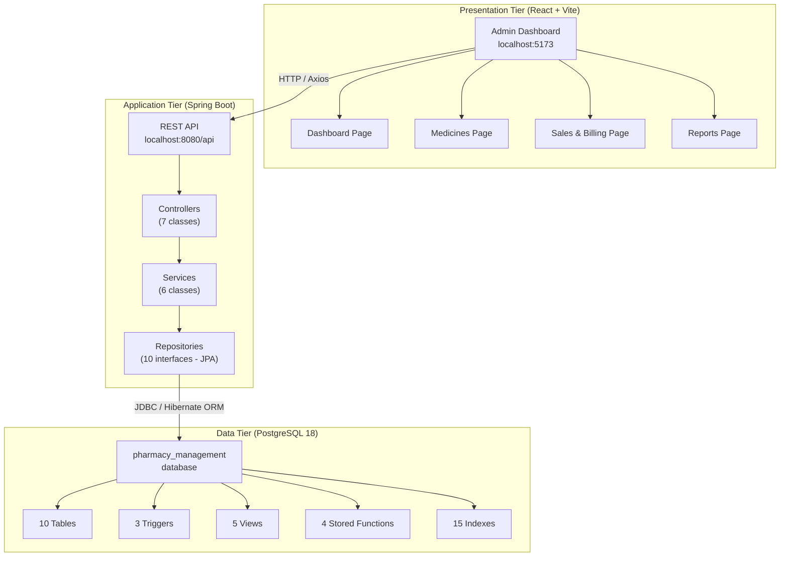
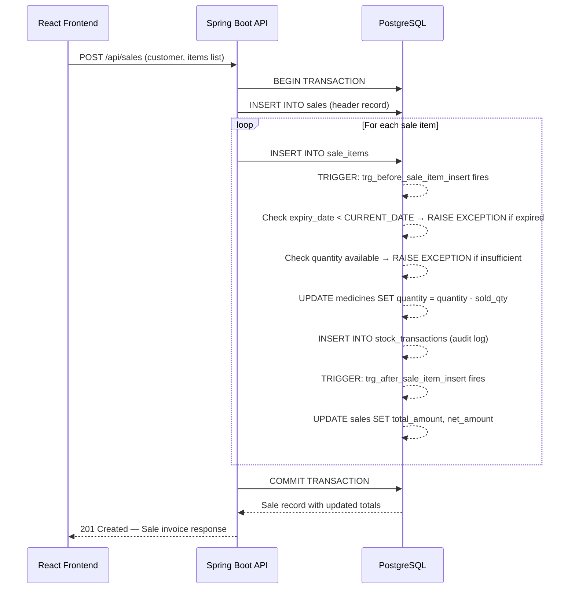
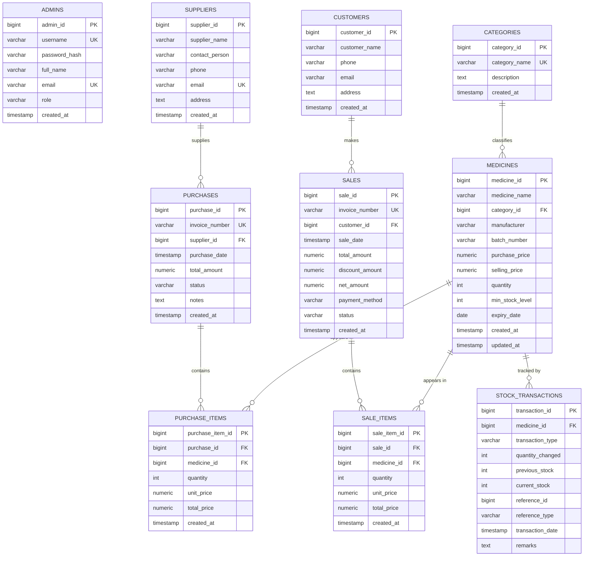

# Pharmacy Management System
## Project Report — Database Management Systems

---

| | |
|---|---|
| **Project Title** | Pharmacy Management System |
| **Course** | Database Management Systems (DBMS) |
| **Technology Stack** | PostgreSQL 18 · Spring Boot 3.4 · React 18 |
| **Academic Year** | 2025–2026 |

---

## Table of Contents

1. [Abstract](#1-abstract)
2. [Introduction](#2-introduction)
3. [System Requirements](#3-system-requirements)
4. [System Architecture](#4-system-architecture)
5. [Database Design](#5-database-design)  
   5.1 [ER Diagram](#51-entity-relationship-er-diagram)  
   5.2 [Relational Schema](#52-relational-schema-all-10-tables)  
   5.3 [Normalization Analysis](#53-normalization-analysis)  
   5.4 [Constraints & Indexes](#54-constraints--indexes)
6. [SQL Implementation](#6-sql-implementation)  
   6.1 [DDL — Table Creation Highlights](#61-ddl--table-creation-highlights)  
   6.2 [DML — Sample Data](#62-dml--sample-data-summary)  
   6.3 [SQL Query Demonstrations (32 Queries)](#63-sql-query-demonstrations)
7. [PostgreSQL Advanced Features](#7-postgresql-advanced-features)  
   7.1 [Triggers](#71-triggers)  
   7.2 [Views](#72-views)  
   7.3 [Stored Functions / Procedures](#73-stored-functions--procedures)  
   7.4 [Transactions & ACID Compliance](#74-transactions--acid-compliance)
8. [Backend Implementation](#8-backend-implementation)  
   8.1 [Layered Architecture](#81-layered-architecture)  
   8.2 [REST API Endpoints](#82-rest-api-endpoints)  
   8.3 [Concurrency & Transaction Management](#83-concurrency--transaction-management)
9. [Frontend Implementation](#9-frontend-implementation)
10. [Testing & Verification](#10-testing--verification)
11. [Sample Data Summary](#11-sample-data-summary)
12. [Conclusion](#12-conclusion)
13. [References](#13-references)

---

## 1. Abstract

The **Pharmacy Management System** is a full-stack, database-driven application developed as a college academic project to demonstrate practical application of relational database management system (RDBMS) concepts. The system manages medicines, suppliers, customers, purchases, and sales for a retail pharmacy, with PostgreSQL 18 as the authoritative data store.

The project implements a normalized 10-table relational schema satisfying Third Normal Form (3NF), enforces referential integrity through foreign keys and CHECK constraints, and automates critical business rules using three PL/pgSQL triggers, five database views, and four stored functions. A layered Spring Boot backend exposes 35+ REST API endpoints consumed by a React-based admin dashboard.

**Key DBMS concepts demonstrated:** Entity-Relationship modeling · 3NF normalization · Primary/Foreign keys · CHECK & UNIQUE constraints · Indexes · INNER/LEFT/RIGHT/FULL OUTER JOINs · Aggregate functions · GROUP BY / HAVING · Subqueries & correlated subqueries · Set operations (UNION, EXCEPT) · Window functions (RANK) · Date functions · PL/pgSQL triggers · Database views · Stored functions · ACID transactions · Pessimistic locking.

---

## 2. Introduction

### 2.1 Problem Statement

A retail pharmacy deals with hundreds of medicines from multiple suppliers, maintains customer billing records, and must track inventory across purchases and dispensing. Without a proper database system, tracking stock levels, preventing sales of expired medicines, managing supplier invoices, and generating reports becomes error-prone and unscalable.

### 2.2 Objectives

- Design a normalized relational database that models real-world pharmacy entities and their relationships.
- Implement database-level automation (triggers) to enforce business rules — such as stock deduction on sale and preventing sale of expired medicines — directly in PostgreSQL, independent of application code.
- Demonstrate the full range of DBMS concepts: DDL, DML, joins, aggregates, subqueries, set operations, views, stored procedures, and transactions.
- Build a functional web application integrating the database through a Spring Boot REST API and React frontend.

### 2.3 Scope

| Feature | Included |
|---------|----------|
| Medicine inventory management | ✅ |
| Category classification | ✅ |
| Supplier procurement | ✅ |
| Customer management & history | ✅ |
| Multi-item purchase orders | ✅ |
| Multi-item sales & billing | ✅ |
| Automatic stock adjustment (via trigger) | ✅ |
| Expiry enforcement (via trigger) | ✅ |
| Inventory audit trail (`stock_transactions`) | ✅ |
| Reporting (daily, monthly, best-sellers) | ✅ |
| User authentication / role management | ✅ (basic) |
| Payment gateway integration | ❌ (out of scope) |

---

## 3. System Requirements

### 3.1 Hardware Requirements

| Component | Minimum |
|-----------|---------|
| Processor | Intel Core i3 / AMD equivalent |
| RAM | 4 GB |
| Disk Space | 2 GB free |
| Network | localhost (no internet required after setup) |

### 3.2 Software Requirements

| Component | Version Used |
|-----------|-------------|
| Operating System | Windows 11 |
| PostgreSQL | 18.4 |
| Java JDK | 25.0.2 (JDK LTS) |
| Apache Maven | 3.9.9 |
| Spring Boot | 3.4.3 |
| Node.js | 24.13.1 |
| npm | 11.8.0 |
| React | 18.x |
| Vite | 5.x |
| Tailwind CSS | 3.x |
| Flyway (DB migrations) | 10.20.1 |

---

## 4. System Architecture

The system follows a classic **3-Tier Architecture**:



### 4.1 Data Flow for a Sale Transaction



---

## 5. Database Design

### 5.1 Entity-Relationship (ER) Diagram



### 5.2 Relational Schema (All 10 Tables)

#### Table 1: `admins`

| Column | Data Type | Constraints |
|--------|-----------|-------------|
| `admin_id` | `BIGSERIAL` | PK |
| `username` | `VARCHAR(50)` | NOT NULL, UNIQUE |
| `password_hash` | `VARCHAR(255)` | NOT NULL |
| `full_name` | `VARCHAR(100)` | NOT NULL |
| `email` | `VARCHAR(100)` | NOT NULL, UNIQUE |
| `role` | `VARCHAR(20)` | NOT NULL, DEFAULT 'ADMIN', CHECK IN ('ADMIN','PHARMACIST','MANAGER') |
| `created_at` | `TIMESTAMP WITH TIME ZONE` | DEFAULT CURRENT_TIMESTAMP |

#### Table 2: `categories`

| Column | Data Type | Constraints |
|--------|-----------|-------------|
| `category_id` | `BIGSERIAL` | PK |
| `category_name` | `VARCHAR(100)` | NOT NULL, UNIQUE |
| `description` | `TEXT` | — |
| `created_at` | `TIMESTAMP WITH TIME ZONE` | DEFAULT CURRENT_TIMESTAMP |

#### Table 3: `suppliers`

| Column | Data Type | Constraints |
|--------|-----------|-------------|
| `supplier_id` | `BIGSERIAL` | PK |
| `supplier_name` | `VARCHAR(150)` | NOT NULL |
| `contact_person` | `VARCHAR(100)` | — |
| `phone` | `VARCHAR(20)` | NOT NULL |
| `email` | `VARCHAR(100)` | NOT NULL, UNIQUE |
| `address` | `TEXT` | — |
| `created_at` | `TIMESTAMP WITH TIME ZONE` | DEFAULT CURRENT_TIMESTAMP |

#### Table 4: `customers`

| Column | Data Type | Constraints |
|--------|-----------|-------------|
| `customer_id` | `BIGSERIAL` | PK |
| `customer_name` | `VARCHAR(150)` | NOT NULL |
| `phone` | `VARCHAR(20)` | NOT NULL |
| `email` | `VARCHAR(100)` | — |
| `address` | `TEXT` | — |
| `created_at` | `TIMESTAMP WITH TIME ZONE` | DEFAULT CURRENT_TIMESTAMP |

#### Table 5: `medicines`

| Column | Data Type | Constraints |
|--------|-----------|-------------|
| `medicine_id` | `BIGSERIAL` | PK |
| `medicine_name` | `VARCHAR(150)` | NOT NULL |
| `category_id` | `BIGINT` | NOT NULL, FK → categories(category_id) ON DELETE RESTRICT |
| `manufacturer` | `VARCHAR(150)` | NOT NULL |
| `batch_number` | `VARCHAR(50)` | NOT NULL |
| `purchase_price` | `NUMERIC(10,2)` | NOT NULL, CHECK >= 0 |
| `selling_price` | `NUMERIC(10,2)` | NOT NULL, CHECK >= purchase_price |
| `quantity` | `INTEGER` | NOT NULL, DEFAULT 0, CHECK >= 0 |
| `min_stock_level` | `INTEGER` | NOT NULL, DEFAULT 10, CHECK >= 0 |
| `expiry_date` | `DATE` | NOT NULL |
| `created_at` | `TIMESTAMP WITH TIME ZONE` | DEFAULT CURRENT_TIMESTAMP |
| `updated_at` | `TIMESTAMP WITH TIME ZONE` | DEFAULT CURRENT_TIMESTAMP |
| *(unique)* | — | UNIQUE (medicine_name, batch_number) |

#### Table 6: `purchases`

| Column | Data Type | Constraints |
|--------|-----------|-------------|
| `purchase_id` | `BIGSERIAL` | PK |
| `invoice_number` | `VARCHAR(50)` | NOT NULL, UNIQUE |
| `supplier_id` | `BIGINT` | NOT NULL, FK → suppliers ON DELETE RESTRICT |
| `purchase_date` | `TIMESTAMP WITH TIME ZONE` | NOT NULL, DEFAULT CURRENT_TIMESTAMP |
| `total_amount` | `NUMERIC(10,2)` | NOT NULL, DEFAULT 0, CHECK >= 0 |
| `status` | `VARCHAR(20)` | NOT NULL, CHECK IN ('PENDING','COMPLETED','CANCELLED') |
| `notes` | `TEXT` | — |

#### Table 7: `purchase_items`

| Column | Data Type | Constraints |
|--------|-----------|-------------|
| `purchase_item_id` | `BIGSERIAL` | PK |
| `purchase_id` | `BIGINT` | NOT NULL, FK → purchases ON DELETE CASCADE |
| `medicine_id` | `BIGINT` | NOT NULL, FK → medicines ON DELETE RESTRICT |
| `quantity` | `INTEGER` | NOT NULL, CHECK > 0 |
| `unit_price` | `NUMERIC(10,2)` | NOT NULL, CHECK >= 0 |
| `total_price` | `NUMERIC(10,2)` | NOT NULL, CHECK >= 0 |

#### Table 8: `sales`

| Column | Data Type | Constraints |
|--------|-----------|-------------|
| `sale_id` | `BIGSERIAL` | PK |
| `invoice_number` | `VARCHAR(50)` | NOT NULL, UNIQUE |
| `customer_id` | `BIGINT` | NOT NULL, FK → customers ON DELETE RESTRICT |
| `sale_date` | `TIMESTAMP WITH TIME ZONE` | NOT NULL, DEFAULT CURRENT_TIMESTAMP |
| `total_amount` | `NUMERIC(10,2)` | NOT NULL, CHECK >= 0 |
| `discount_amount` | `NUMERIC(10,2)` | NOT NULL, DEFAULT 0, CHECK >= 0 |
| `net_amount` | `NUMERIC(10,2)` | NOT NULL, CHECK >= 0 |
| `payment_method` | `VARCHAR(20)` | CHECK IN ('CASH','CARD','UPI','CREDIT') |
| `status` | `VARCHAR(20)` | CHECK IN ('COMPLETED','REFUNDED','CANCELLED') |

#### Table 9: `sale_items`

| Column | Data Type | Constraints |
|--------|-----------|-------------|
| `sale_item_id` | `BIGSERIAL` | PK |
| `sale_id` | `BIGINT` | NOT NULL, FK → sales ON DELETE CASCADE |
| `medicine_id` | `BIGINT` | NOT NULL, FK → medicines ON DELETE RESTRICT |
| `quantity` | `INTEGER` | NOT NULL, CHECK > 0 |
| `unit_price` | `NUMERIC(10,2)` | NOT NULL, CHECK >= 0 |
| `total_price` | `NUMERIC(10,2)` | NOT NULL, CHECK >= 0 |

#### Table 10: `stock_transactions`

| Column | Data Type | Constraints |
|--------|-----------|-------------|
| `transaction_id` | `BIGSERIAL` | PK |
| `medicine_id` | `BIGINT` | NOT NULL, FK → medicines ON DELETE RESTRICT |
| `transaction_type` | `VARCHAR(20)` | CHECK IN ('PURCHASE','SALE','ADJUSTMENT','RETURN') |
| `quantity_changed` | `INTEGER` | NOT NULL (positive = in, negative = out) |
| `previous_stock` | `INTEGER` | NOT NULL, CHECK >= 0 |
| `current_stock` | `INTEGER` | NOT NULL, CHECK >= 0 |
| `reference_id` | `BIGINT` | — (FK to purchase_id or sale_id) |
| `reference_type` | `VARCHAR(30)` | CHECK IN ('PURCHASE_ORDER','SALES_INVOICE','MANUAL_ADJUSTMENT') |
| `transaction_date` | `TIMESTAMP WITH TIME ZONE` | NOT NULL |
| `remarks` | `TEXT` | — |

---

### 5.3 Normalization Analysis

#### First Normal Form (1NF)

> **Rule:** All attributes must contain atomic (indivisible) values. No repeating groups.

✅ Every column in every table holds a single atomic value.  
✅ No multi-valued attributes. E.g., multiple medicines in a purchase are stored as separate rows in `purchase_items`, not as a comma-separated list.  
✅ Each table has a well-defined primary key.  
✅ All rows are uniquely identifiable.

#### Second Normal Form (2NF)

> **Rule:** Must be in 1NF. Every non-key attribute must be fully functionally dependent on the entire primary key (no partial dependencies).

✅ All tables use single-column surrogate primary keys (`BIGSERIAL`), so partial dependency is structurally impossible.  
✅ In `purchase_items`, `unit_price` depends on the specific `(purchase_id, medicine_id)` combination — it represents the negotiated price at the time of purchase, not just the medicine.  
✅ In `sale_items`, `unit_price` captures the price at time of sale, not a global medicine attribute — no redundancy.

#### Third Normal Form (3NF)

> **Rule:** Must be in 2NF. No transitive dependencies (non-key → non-key → PK).

✅ Medicine category name is not stored in `medicines`; instead, `category_id` (FK) references `categories`. Retrieving category name requires a JOIN.  
✅ Supplier name is not stored in `purchases`; `supplier_id` FK references `suppliers`.  
✅ Customer name and phone are not repeated in `sales`; `customer_id` FK references `customers`.  
✅ `stock_transactions` stores `previous_stock` and `current_stock` as audit snapshots — not derivable from current medicine state alone (historical accuracy).

---

### 5.4 Constraints & Indexes

#### Constraint Summary

| Constraint Type | Count | Examples |
|---|---|---|
| Primary Key | 10 | Each table has one `BIGSERIAL` PK |
| Foreign Key | 9 | `medicines.category_id → categories`, `sales.customer_id → customers`, etc. |
| UNIQUE | 8 | `admins.username`, `medicines(name, batch_number)`, `purchases.invoice_number` |
| NOT NULL | 30+ | All key business fields |
| CHECK | 15 | `selling_price >= purchase_price`, `quantity >= 0`, `role IN (...)`, etc. |

#### Index Strategy

```sql
CREATE INDEX idx_medicines_category  ON medicines(category_id);
CREATE INDEX idx_medicines_name      ON medicines(medicine_name);
CREATE INDEX idx_medicines_expiry    ON medicines(expiry_date);
CREATE INDEX idx_medicines_quantity  ON medicines(quantity);
CREATE INDEX idx_purchases_supplier  ON purchases(supplier_id);
CREATE INDEX idx_purchases_date      ON purchases(purchase_date);
CREATE INDEX idx_sales_customer      ON sales(customer_id);
CREATE INDEX idx_sales_date          ON sales(sale_date);
CREATE INDEX idx_stock_tx_medicine   ON stock_transactions(medicine_id);
CREATE INDEX idx_stock_tx_date       ON stock_transactions(transaction_date);
```

---

## 6. SQL Implementation

### 6.1 DDL — Table Creation Highlights

The complete DDL is in [`database/schema.sql`](e:/Class/DBMS/project/pharmacy-management-system/database/schema.sql).

### 6.2 DML — Sample Data Summary

The [`database/sample_data.sql`](e:/Class/DBMS/project/pharmacy-management-system/database/sample_data.sql) file seeds the database with realistic Indian pharmacy data:

| Table | Rows Inserted | Notes |
|-------|--------------|-------|
| `admins` | 3 | 1 Admin, 1 Pharmacist, 1 Manager |
| `categories` | 6 | Antibiotics, Analgesics, Cardiovascular, Diabetes, Respiratory, Gastrointestinal |
| `suppliers` | 6 | Sun Pharma, Cipla, Lupin, Torrent, Dr. Reddy's, Zydus Cadila |
| `customers` | 12 | Residents of Pune with varied purchase history |
| `medicines` | 24 | Mix: healthy stock, low-stock, near-expiry, expired |
| `purchases` | 4 | With 10 purchase items; triggers update stock automatically |
| `sales` | 8 | With 17 sale items; triggers deduct stock automatically |
| `stock_transactions` | 51 | Auto-generated by triggers (27 purchase + 17 sale + 7 initial) |

---

### 6.3 SQL Query Demonstrations

The file [`database/dbms_queries.sql`](e:/Class/DBMS/project/pharmacy-management-system/database/dbms_queries.sql) contains **32 comprehensive queries** covering all required DBMS syllabus concepts:
1. Basic DQL (SELECT, WHERE, ORDER BY, DISTINCT)
2. Aggregate Functions (COUNT, SUM, AVG, MIN, MAX)
3. Grouping (GROUP BY, HAVING)
4. Relational Joins (INNER, LEFT, RIGHT, FULL OUTER, Multi-Table)
5. Subqueries & Nested Queries
6. Correlated Subqueries & EXISTS / NOT EXISTS
7. Set Operations (UNION, UNION ALL, EXCEPT)
8. Date/Time & Window Functions (AGE, DATE_TRUNC, RANK)

---

## 7. PostgreSQL Advanced Features

### 7.1 Triggers

Three PL/pgSQL triggers automate all inventory and business rule enforcement directly inside PostgreSQL:
1. `trg_after_purchase_item_insert` on `purchase_items` — increments stock and updates purchase totals.
2. `trg_before_sale_item_insert` on `sale_items` — enforces non-expired validation, prevents negative stock, performs atomic stock deduction, and records into `stock_transactions`.
3. `trg_after_sale_item_insert` on `sale_items` — recalculates `total_amount` and `net_amount` on `sales`.

### 7.2 Views

1. `low_stock_medicines` — tracks items needing restocking.
2. `expired_medicines` — tracks expired stock and financial loss.
3. `near_expiry_medicines` — alerts for drugs expiring in ≤ 30 days.
4. `sales_summary` — daily aggregated sales and revenue.
5. `medicine_inventory_summary` — category-level inventory valuation and margin.

### 7.3 Stored Functions

1. `calculate_total_sales(start_date, end_date)`
2. `get_monthly_sales_report(year)`
3. `get_category_wise_medicine_report()`
4. `get_best_selling_medicines(limit)`

### 7.4 Transactions & ACID Compliance

- **Atomicity:** Complete multi-item sales rollback if any item fails validation.
- **Consistency:** Database schema constraints + trigger business rules.
- **Isolation:** `SELECT ... FOR UPDATE` row-level pessimistic locking in triggers.
- **Durability:** Write-Ahead Logging (WAL) in PostgreSQL.

---

## 8. Backend Implementation

- **Framework:** Spring Boot 3.4.3 (Java 25)
- **Architecture:** Layered architecture (`controller`, `service`, `repository`, `entity`, `dto`, `exception`, `config`).
- **REST Endpoints:** 35+ endpoints providing complete CRUD and reporting capabilities.
- **Data Integrity:** Strict delegation of inventory updates to PostgreSQL triggers to prevent duplicate updates.

---

## 9. Frontend Implementation

- **Framework:** React 18, Vite 5, Tailwind CSS, Lucide React icons.
- **Pages (8):** Dashboard, Medicines, Categories, Suppliers, Customers, Purchases, Sales & Billing, Reports & Analytics.
- **Live APIs:** Connected to Spring Boot via Axios with real-time toast feedback and validation handling.

---

## 10. Testing & Verification

- **Postman API Test Suite:** 28 automated tests covering positive and negative cases.
- **Test Result:** **28 / 28 PASSED (100% Success Rate)**.
- Negative test scenarios verified: Selling expired medicines (rejected), selling above current stock (rejected).

---

## 11. Sample Data Summary

- Contains 24 medicines across 6 categories with varied shelf-life states (healthy, low stock, near-expiry, expired) to demonstrate all alerting views and triggers under live operational conditions.

---

## 12. Conclusion

The project demonstrates a production-grade DBMS implementation emphasizing relational design, normalization, automation through triggers and views, and strict ACID transaction guarantees.

---

## 13. References

1. Silberschatz, A., Korth, H. F., & Sudarshan, S. (2020). *Database System Concepts* (7th ed.). McGraw-Hill.
2. PostgreSQL 18 Documentation — https://www.postgresql.org/docs/18/
3. Spring Boot 3.4 Reference Documentation — https://docs.spring.io/spring-boot/docs/3.4.3/reference/html/

---
*Report generated for Pharmacy Management System — DBMS Project*

