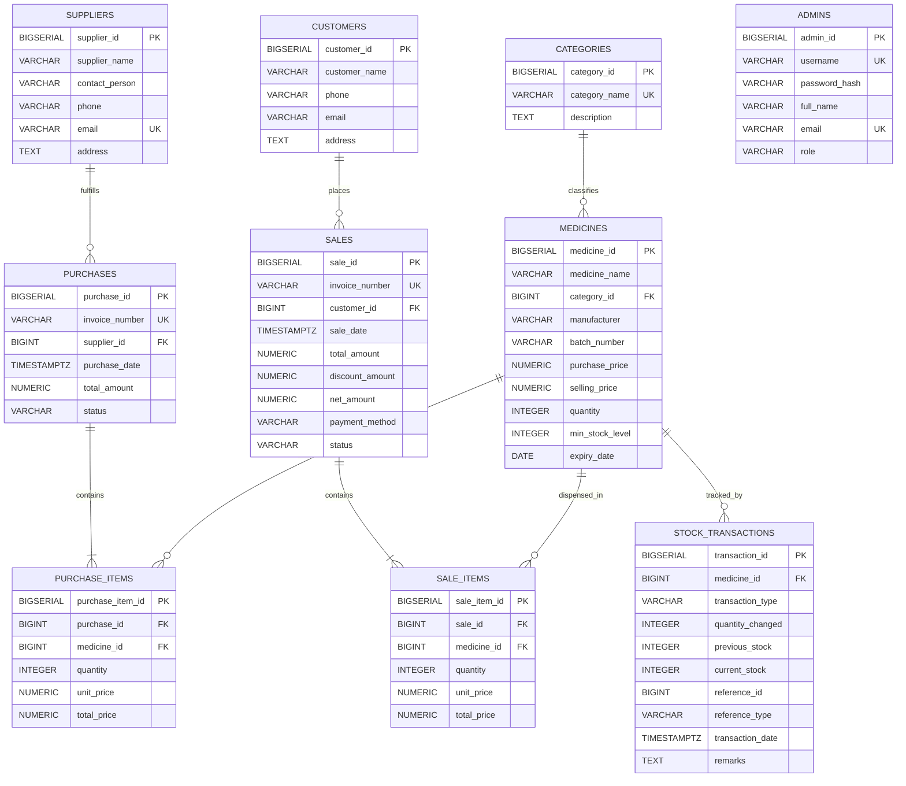

# Pharmacy Management System (DBMS Academic Project)

A complete, full-stack, database-driven **Pharmacy Management System** engineered for a college DBMS course. This application prioritizes relational database design, SQL queries, normalization, ACID transactions, joins, views, triggers, and stored procedures in PostgreSQL, integrated with a Java Spring Boot REST backend and a clean, responsive React.js (Vite + Tailwind CSS) frontend.

---

## 1. Technology Stack

- **Database:** PostgreSQL 18.4, PL/pgSQL
- **Backend:** Java 21 / 25 LTS, Spring Boot 3.4.3, Spring Data JPA, Hibernate, Spring Boot Validation, Flyway 10.20.1, Maven 3.9.9
- **Frontend:** React.js 18, Vite 5, Tailwind CSS 3, React Router DOM 6, Axios, Lucide React
- **API Testing:** Postman Collection v2.1, Automated Node.js Test Suite

---

## 2. Relational Database Architecture (10 Tables)

The database schema strictly adheres to **Third Normal Form (3NF)**:



---

## 3. Database Automation & DBMS Implementation

### A. PostgreSQL Triggers (`triggers.sql`)

1. **`trg_after_purchase_item_insert`**:
   - Executes after each inbound purchase item is inserted.
   - Automatically increments `medicines.quantity`.
   - Records an immutable audit log entry in `stock_transactions`.
   - Recalculates parent `purchases.total_amount`.

2. **`trg_before_sale_item_insert`**:
   - Executes before each sale item is inserted.
   - Locks target medicine with `SELECT ... FOR UPDATE` (concurrency-safe row locking).
   - Validates that the medicine is **not expired** (`expiry_date >= CURRENT_DATE`). If expired, aborts transaction via `RAISE EXCEPTION`.
   - Validates that sufficient inventory is available (`quantity >= requested`). If insufficient, aborts transaction via `RAISE EXCEPTION`.
   - Automatically decreases `medicines.quantity`.
   - Enforces non-negative inventory constraint.
   - Records an audit log entry in `stock_transactions`.

3. **`trg_after_sale_item_insert`**:
   - Updates `sales.total_amount` and `sales.net_amount` based on line item sum minus discounts.

### B. PostgreSQL Views (`views.sql`)

1. `low_stock_medicines`: Identifies medicines where `quantity <= min_stock_level`.
2. `expired_medicines`: Lists all medicines past their expiration date with projected financial loss.
3. `near_expiry_medicines`: Flags medicines expiring within 30 days.
4. `sales_summary`: Aggregated daily sales report with gross revenue, discounts, net revenue, and average bill value.
5. `medicine_inventory_summary`: Category-level inventory valuation, stock counts, and projected profit.

### C. PostgreSQL Stored Functions (`functions.sql`)

1. `calculate_total_sales(p_start_date, p_end_date)`: Computes net revenue within timestamp interval.
2. `get_monthly_sales_report(p_year)`: Returns tabular monthly breakdown of sales orders and revenue.
3. `get_best_selling_medicines(p_limit)`: Ranks top-performing medicines by quantity sold and revenue.
4. `get_category_wise_medicine_report()`: Computes multi-table join summary across categories, inventory, and sales.

### D. 30+ Relational DBMS Queries (`dbms_queries.sql`)

Demonstrates:

- `SELECT`, `WHERE`, `ORDER BY`, `BETWEEN`, `ILIKE`
- Aggregate functions: `COUNT()`, `SUM()`, `AVG()`, `MIN()`, `MAX()`
- `GROUP BY` and `HAVING` thresholds
- Joins: `INNER JOIN`, `LEFT JOIN`, `RIGHT JOIN`, `FULL OUTER JOIN`, and 5-Table Multiple Joins
- Subqueries (Single-row, Multi-row `IN`, `NOT IN`, Derived Tables)
- Correlated Subqueries and `EXISTS` / `NOT EXISTS`
- Set operations: `UNION`, `UNION ALL`, `EXCEPT`
- Date functions (`AGE`, `DATE_TRUNC`, `EXTRACT`) and window functions (`RANK()`)

---

## 4. Project Directory Structure

```
pharmacy-management-system/
├── backend/
│   ├── src/main/java/com/pharmacy/
│   │   ├── config/          # CORS and Web configuration
│   │   ├── controller/      # REST API controllers
│   │   ├── dto/             # Request & Response Data Transfer Objects
│   │   ├── entity/          # JPA Entities mapping 10 tables
│   │   ├── exception/       # Centralized exception handler
│   │   ├── repository/      # Spring Data JPA repositories with row locking
│   │   └── service/         # Transactional business logic
│   ├── src/main/resources/
│   │   ├── application.properties
│   │   └── db/migration/    # Flyway migration scripts
│   └── pom.xml
├── frontend/
│   ├── src/
│   │   ├── components/      # Reusable Modals, AlertBanners, Navbars
│   │   ├── layouts/         # Clean Admin dashboard layout
│   │   ├── pages/           # 8 Core management pages
│   │   ├── services/        # Axios API client
│   │   ├── App.jsx
│   │   └── main.jsx
│   ├── package.json
│   └── tailwind.config.js
├── database/
│   ├── schema.sql           # 10 Tables, Constraints, Indexes
│   ├── triggers.sql         # PL/pgSQL Triggers & Audit Logging
│   ├── views.sql            # 5 PostgreSQL views
│   ├── functions.sql        # PL/pgSQL Stored Procedures & Functions
│   ├── sample_data.sql      # Realistic demonstration data
│   └── dbms_queries.sql     # 32 Comprehensive DBMS SQL queries
├── postman/
│   ├── Pharmacy_Management_System.postman_collection.json
│   ├── Pharmacy_Management_System.postman_environment.json
│   ├── run_postman_tests.js # Automated collection test runner
│   └── test_results.json    # Automated test execution report (28/28 passed)
├── documentation/
│   ├── ER_Diagram.md        # Mermaid ER diagram & cardinality rules
│   ├── Database_Design.md   # Normalization (1NF to 3NF) & constraint rules
│   └── API_Documentation.md # Detailed REST API documentation
└── README.md
```

---

## 5. How to Run the Application Locally

### Step 1: Database Setup

1. Open PostgreSQL (pgAdmin or psql) and connect to `127.0.0.1:5432`.
2. Create the database:
   ```sql
   CREATE DATABASE pharmacy_management;
   ```
3. Execute SQL scripts:
   ```powershell
   $env:PGPASSWORD = 'YourPassword'
   psql -U postgres -h localhost -d pharmacy_management -f database/schema.sql
   psql -U postgres -h localhost -d pharmacy_management -f database/triggers.sql
   psql -U postgres -h localhost -d pharmacy_management -f database/views.sql
   psql -U postgres -h localhost -d pharmacy_management -f database/functions.sql
   psql -U postgres -h localhost -d pharmacy_management -f database/sample_data.sql
   ```

### Step 2: Run Spring Boot Backend

Configure environment variables if needed (`DB_USER`, `DB_PASSWORD`, `DB_NAME`, `DB_HOST`), then start the backend:

```powershell
cd pharmacy-management-system/backend
mvn clean package -DskipTests
java -jar target/pharmacy-management-system-1.0.0.jar
```

_Backend URL:_ `http://localhost:8080/api`

### Step 3: Run React Frontend

```powershell
cd pharmacy-management-system/frontend
npm install
npm run dev
```

_Frontend URL:_ `http://localhost:5173/`

### Step 4: Run Postman Automated Test Suite

```powershell
node pharmacy-management-system/postman/run_postman_tests.js
```

---

## 6. Test Verification Report

```
================================================================
   PHARMACY MANAGEMENT SYSTEM - AUTOMATED API TEST SUITE
================================================================

📁 FOLDER: Categories
  ✅ [PASS] Get All Categories (HTTP 200)
  ✅ [PASS] Get Category by ID (HTTP 200)
  ✅ [PASS] Add Category (Positive) (HTTP 201)
  ✅ [PASS] Add Duplicate Category (Negative) (HTTP 400)

📁 FOLDER: Medicines
  ✅ [PASS] Get All Medicines (HTTP 200)
  ✅ [PASS] Search Medicines (HTTP 200)
  ✅ [PASS] Get Low Stock Medicines View (HTTP 200)
  ✅ [PASS] Get Expired Medicines View (HTTP 200)
  ✅ [PASS] Add Medicine (Positive) (HTTP 201)
  ✅ [PASS] Add Medicine - Negative Price (Negative) (HTTP 400)
  ✅ [PASS] Add Medicine - Selling < Purchase (Negative) (HTTP 400)
  ✅ [PASS] Get Medicine by Invalid ID (Negative) (HTTP 404)

📁 FOLDER: Suppliers
  ✅ [PASS] Get All Suppliers (HTTP 200)
  ✅ [PASS] Add Supplier (Positive) (HTTP 201)

📁 FOLDER: Customers
  ✅ [PASS] Get All Customers (HTTP 200)
  ✅ [PASS] Add Customer (Positive) (HTTP 201)

📁 FOLDER: Purchases (Stock Increase)
  ✅ [PASS] Get All Purchases (HTTP 200)
  ✅ [PASS] Create Purchase (Increases Stock via Trigger) (HTTP 201)

📁 FOLDER: Sales (Stock Decrease & Validation)
  ✅ [PASS] Get All Sales (HTTP 200)
  ✅ [PASS] Create Sale (Positive - Decreases Stock via Trigger) (HTTP 201)
  ✅ [PASS] Create Sale - Selling Expired Medicine (Negative - Rejected by Trigger) (HTTP 400)
  ✅ [PASS] Create Sale - Selling Exceeding Stock (Negative - Rejected by Trigger) (HTTP 400)

📁 FOLDER: Reports & Analytics
  ✅ [PASS] Get Dashboard Metrics (HTTP 200)
  ✅ [PASS] Get Monthly Report (Function) (HTTP 200)
  ✅ [PASS] Get Best Sellers (Function) (HTTP 200)
  ✅ [PASS] Get Daily Sales Summary (View) (HTTP 200)
  ✅ [PASS] Get Category Inventory Summary (View) (HTTP 200)
  ✅ [PASS] Get Stock Audit Transactions (Trigger Log) (HTTP 200)

================================================================
TEST SUMMARY: Total: 28 | Passed: 28 | Failed: 0 (100% Pass)
================================================================
```

java -jar target/pharmacy-management-system-1.0.0.jar
