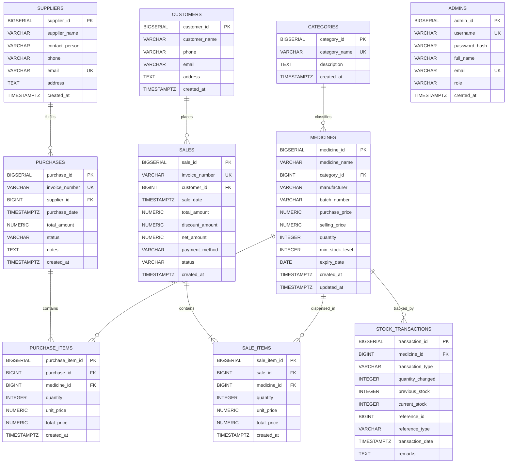

# Pharmacy Management System - Entity Relationship (ER) Diagram

## 1. Conceptual Model Overview
The **Pharmacy Management System** relational database model is designed up to **Third Normal Form (3NF)**. It ensures complete referential integrity, eliminates update/delete anomalies, enforces ACID compliance, and provides automated inventory synchronization through PostgreSQL triggers.

---

## 2. Cardinality and Multiplicity Rules

| Parent Entity | Child Entity | Cardinality | Business Meaning |
| :--- | :--- | :--- | :--- |
| `CATEGORIES` | `MEDICINES` | **1 : N** | A category can classify multiple medicines. Each medicine must belong to exactly one category. |
| `SUPPLIERS` | `PURCHASES` | **1 : N** | A supplier can provide zero, one, or many purchase shipments. Each purchase order is fulfilled by one supplier. |
| `PURCHASES` | `PURCHASE_ITEMS`| **1 : N** | A purchase order contains one or more line items. Deleting a purchase cascades to its line items. |
| `MEDICINES` | `PURCHASE_ITEMS`| **1 : N** | A medicine can appear across multiple inbound purchase orders. |
| `CUSTOMERS` | `SALES` | **1 : N** | A customer can make multiple purchases over time. Every sale invoice references one customer. |
| `SALES` | `SALE_ITEMS` | **1 : N** | A sale invoice contains one or more dispensed medicines. Deleting a sale cascades to its line items. |
| `MEDICINES` | `SALE_ITEMS` | **1 : N** | A medicine can be dispensed across many customer invoices. |
| `MEDICINES` | `STOCK_TRANSACTIONS` | **1 : N** | Every quantity modification (purchase, sale, manual adjustment) generates an immutable audit record. |

